<div align="center">

# 🐾 Bigotes Felices — Frontend

**Aplicación web del refugio de mascotas Bigotes Felices.**
Adopción en línea para el público y paneles de trabajo para veterinarios, cuidadores y administradores.


Backend: **[Refugio-Backend](https://github.com/JuaniMP/Refugio-Backend)** (Spring Boot + MySQL)


</div>

---

## 📑 Contenido

- [Qué hace](#-qué-hace)
- [Capturas por rol](#-capturas-por-rol)
- [Arquitectura y patrones](#-arquitectura-y-patrones)
- [Estructura](#-estructura)
- [Cómo ejecutarlo](#-cómo-ejecutarlo)
- [Cómo probarlo](#-cómo-probarlo)

---

## ✨ Qué hace

| Rol | Puede… |
|---|---|
| **Visitante** | Ver el catálogo de mascotas disponibles y registrarse con verificación por correo. |
| **Adoptante** | Enviar solicitudes de adopción con un cuestionario de compromiso, seguir su estado y editar su perfil. |
| **Veterinario** | Buscar una mascota, registrar diagnósticos, aplicar vacunas y consultar su historial clínico. Solo ve las especies de su especialidad. |
| **Cuidador** | Iniciar y terminar su turno, ver las mascotas de su zona y anotar la bitácora de cada una. |
| **Administrador** | Estadísticas, refugio, especies, razas, mascotas, personal (con contraseña temporal por correo), vacunas, solicitudes y auditoría. |

---

## 📸 Capturas por rol

> Tomadas con el frontend y el backend corriendo en local con los datos de demostración del backend.

### Público

| Catálogo | Inicio de sesión | Registro |
|---|---|---|
|  | 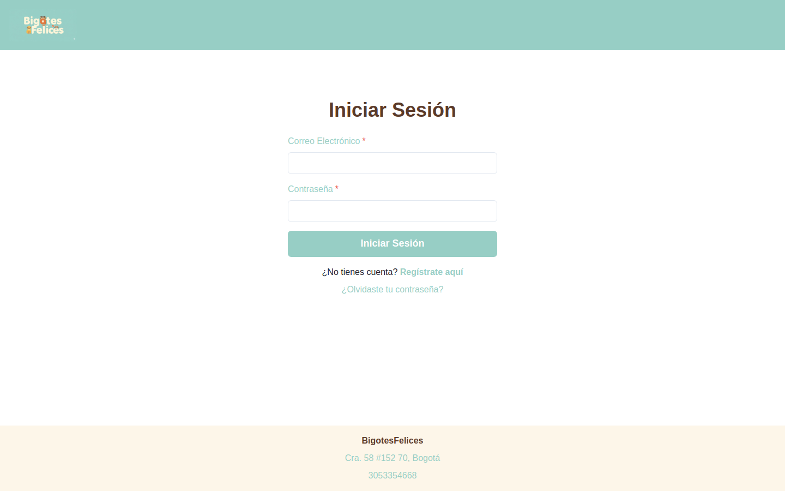 | 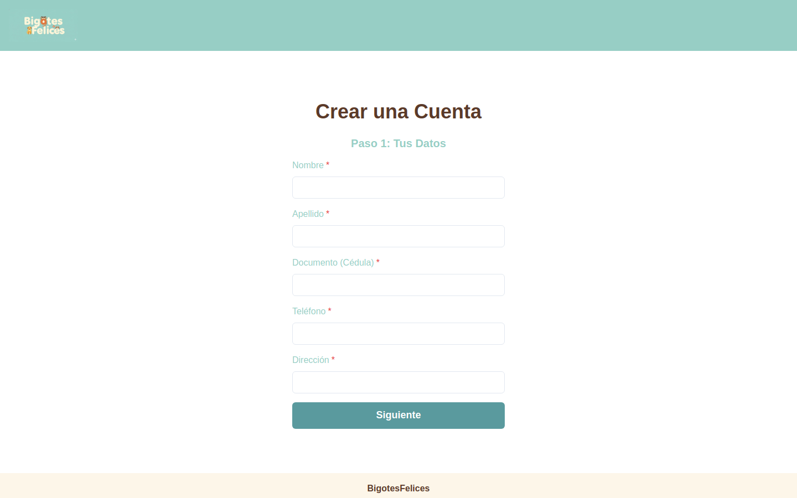 |

### Adoptante

| Solicitud de adopción | Mis solicitudes | Perfil |
|---|---|---|
| 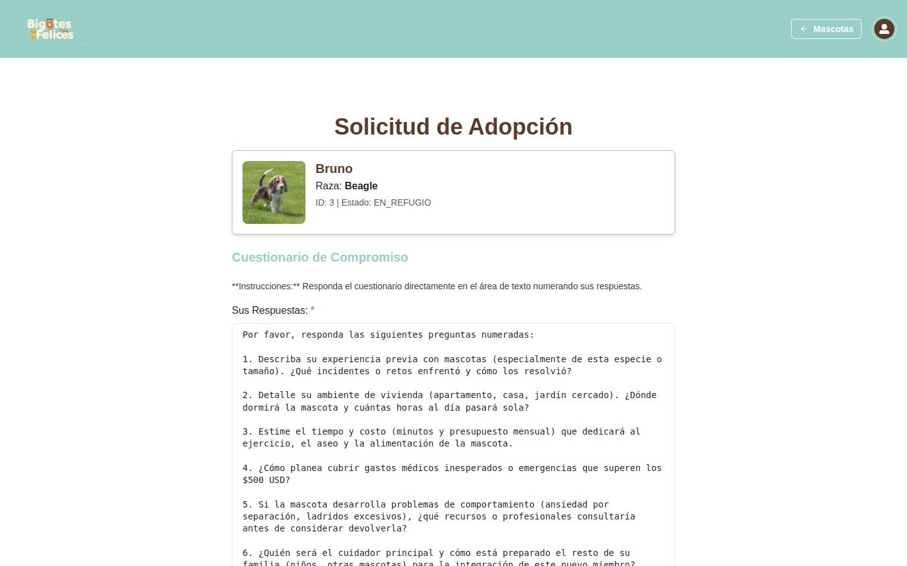 | 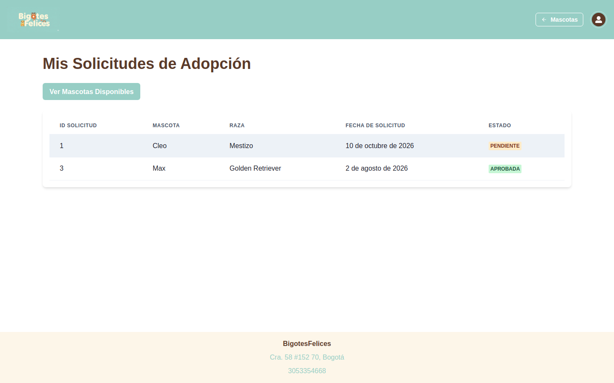 | 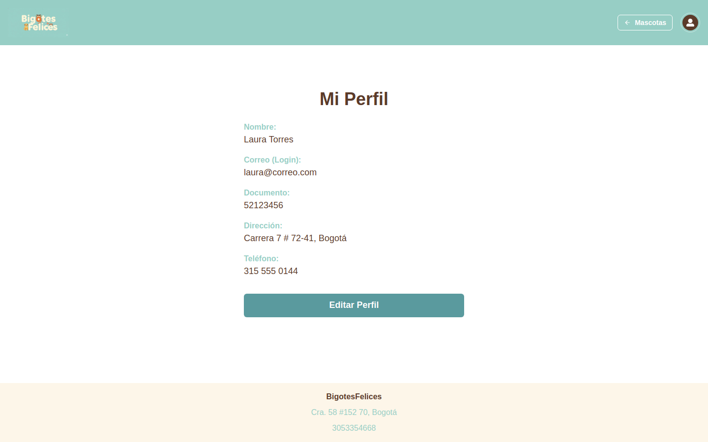 |

### Veterinario y cuidador

| Panel veterinario | Ficha clínica | Panel del cuidador |
|---|---|---|
| 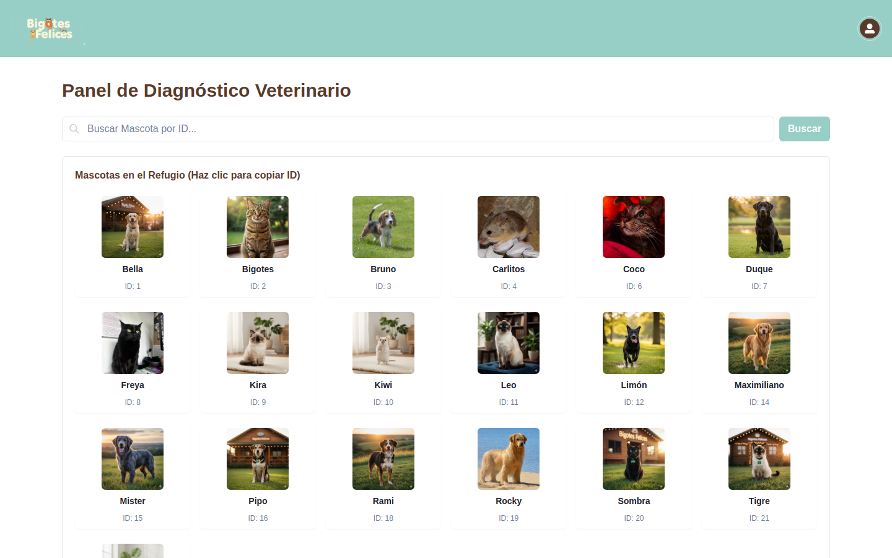 | 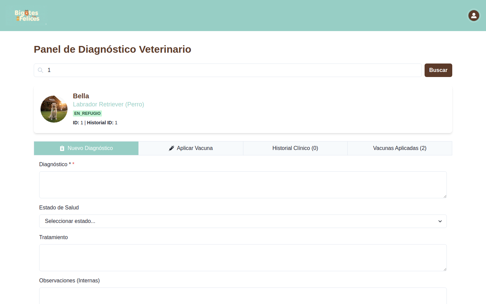 | 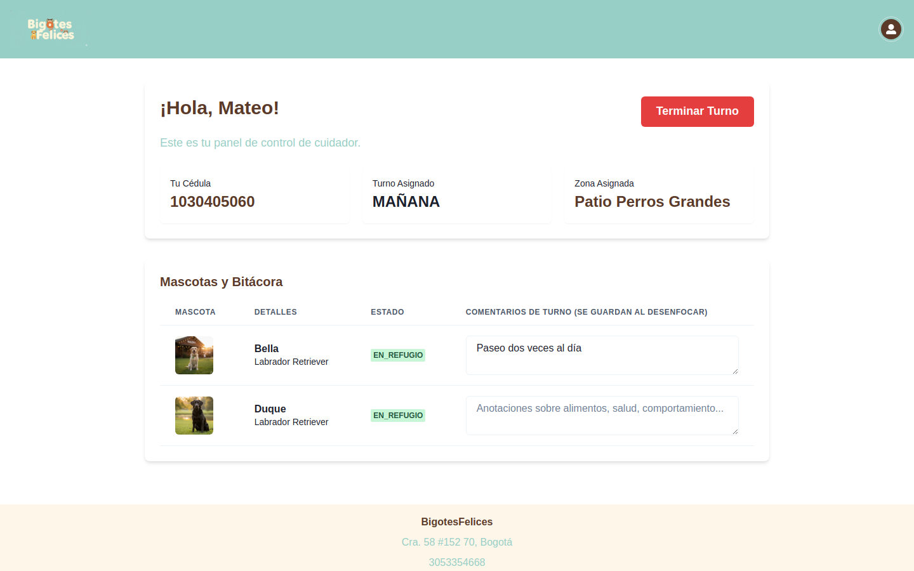 |

### Administrador

| Estadísticas | Mascotas | Solicitudes |
|---|---|---|
|  | 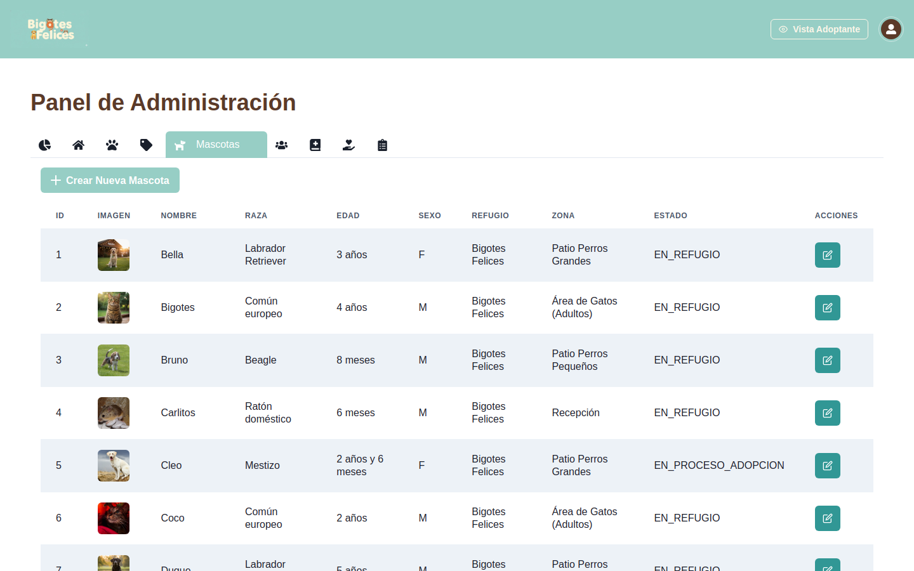 | 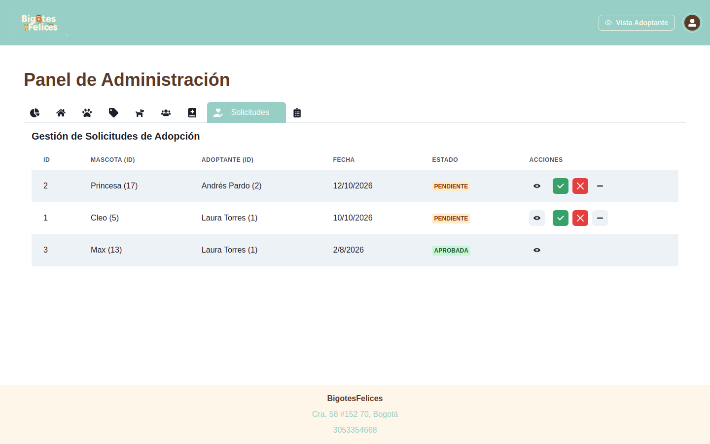 |

| Personal | Alta de veterinario (asistente) | Auditoría |
|---|---|---|
| 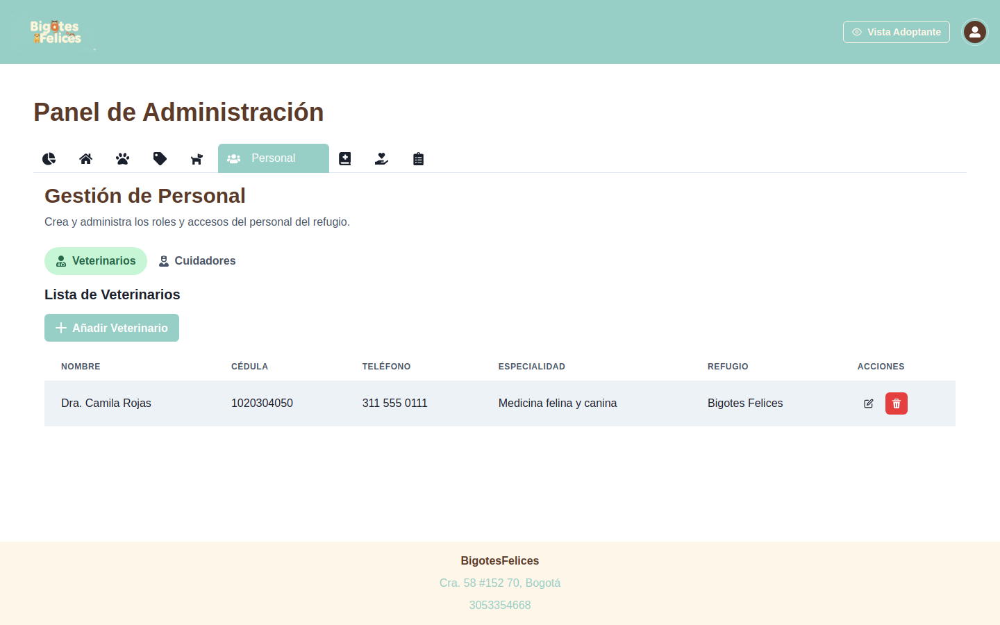 | 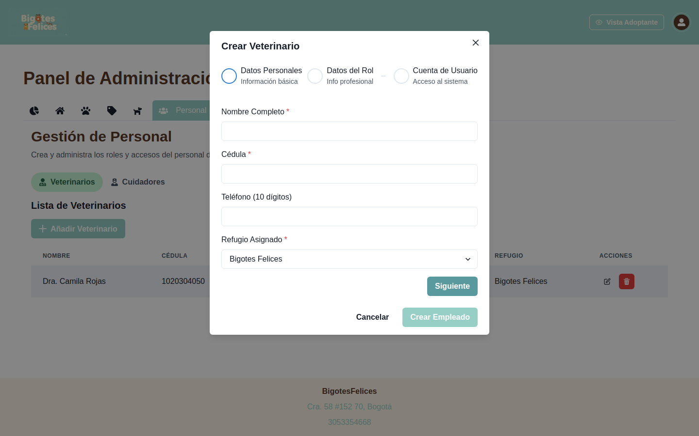 |  |

---

## 🧩 Arquitectura y patrones

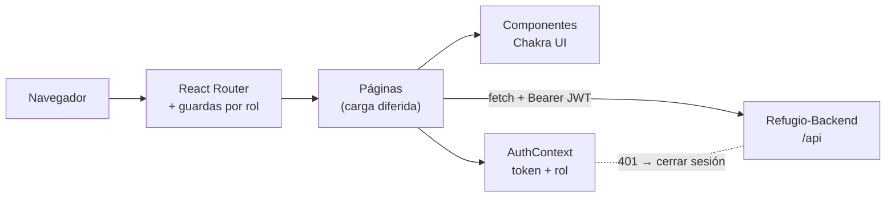

| Patrón | Dónde | Para qué |
|---|---|---|
| **Provider / Context** | `context/AuthContext.jsx` | Sesión (token y rol) disponible en toda la app; cierra sesión sola si la API responde 401. |
| **Route Guard** | `components/auth/AdminRoute`, `VeterinarioRoute`, `CuidadorRoute` | Cada panel solo se abre con el rol correcto. |
| **Composición (slots)** | `admin/personal/PersonalFormWizard` recibe `camposRol` | Un mismo asistente de 3 pasos sirve para veterinarios y cuidadores; cada rol solo aporta su paso 2. |
| **Componentes reutilizables** | `admin/personal/EmpleadoFields`, `pets/PetCard`, `layout/` | Los datos del empleado y las tarjetas se escriben una sola vez. |
| **Configuración centralizada** | `config/api.js`, `constants/refugio.js` | Una sola URL del backend (antes estaba escrita en 67 lugares) y una sola lista de zonas, turnos y especialidades. |
| **Lazy loading** | `App.jsx` | Cada página se descarga al visitarla (bundle inicial 866 KB → 556 KB). |

---

## 📂 Estructura

```
src/
├── App.jsx                 rutas (públicas y protegidas por rol)
├── config/api.js           URL del backend (VITE_API_URL)
├── constants/refugio.js    zonas, turnos y especialidades
├── context/AuthContext.jsx sesión
├── pages/                  una página por pantalla
├── components/
│   ├── admin/              pestañas del panel de administración
│   │   └── personal/       formulario compartido de veterinarios y cuidadores
│   ├── auth/               guardas de rutas por rol
│   ├── layout/             cabecera, pie y layout
│   └── pets/               tarjeta de mascota
public/images/pets/         fotos de las mascotas (y default.svg)
docs/screenshots/           capturas de este README
```

---

## 🚀 Cómo ejecutarlo

Requisitos: **Node.js 20+** y el [backend](https://github.com/JuaniMP/Refugio-Backend) corriendo en `http://localhost:8181`.

```bash
git clone https://github.com/JuaniMP/Refugio-Frontend.git
cd Refugio-Frontend
cp .env.example .env      # opcional: cambia VITE_API_URL si el backend está en otra URL
npm install
npm run dev               # http://localhost:5173
```

### Usuarios de demostración

Se crean con `database/setup.sh` del backend. Contraseña de todos: **`Demo1234*`**

| Rol | Usuario |
|---|---|
| Administrador | `admin@refugio.com` |
| Veterinario | `vet@refugio.com` |
| Cuidador | `cuidador@refugio.com` |
| Adoptante | `laura@correo.com` |

---

## 🧪 Cómo probarlo

```bash
npm run lint    # sin errores
npm run build   # build de producción
```

Recorrido sugerido:

1. Sin iniciar sesión, revisa el catálogo y **regístrate**: el código de verificación llega a [Mailpit](http://localhost:8025) si el backend usa el perfil `dev`.
2. Como `laura@correo.com`, pulsa **Adoptar** en una mascota y envía la solicitud; aparece en **Mis solicitudes**.
3. Como `admin@refugio.com`, apruébala en **Solicitudes** y crea un veterinario desde **Personal**: recibe una contraseña temporal por correo y debe cambiarla al entrar.
4. Como `vet@refugio.com`, busca la mascota con ID `1` y registra un diagnóstico.
5. Como `cuidador@refugio.com`, inicia el turno y anota la bitácora de las mascotas de tu zona.

---

<div align="center">

Hecho por **[Juanita Mejía](https://github.com/JuaniMP)**

</div>
